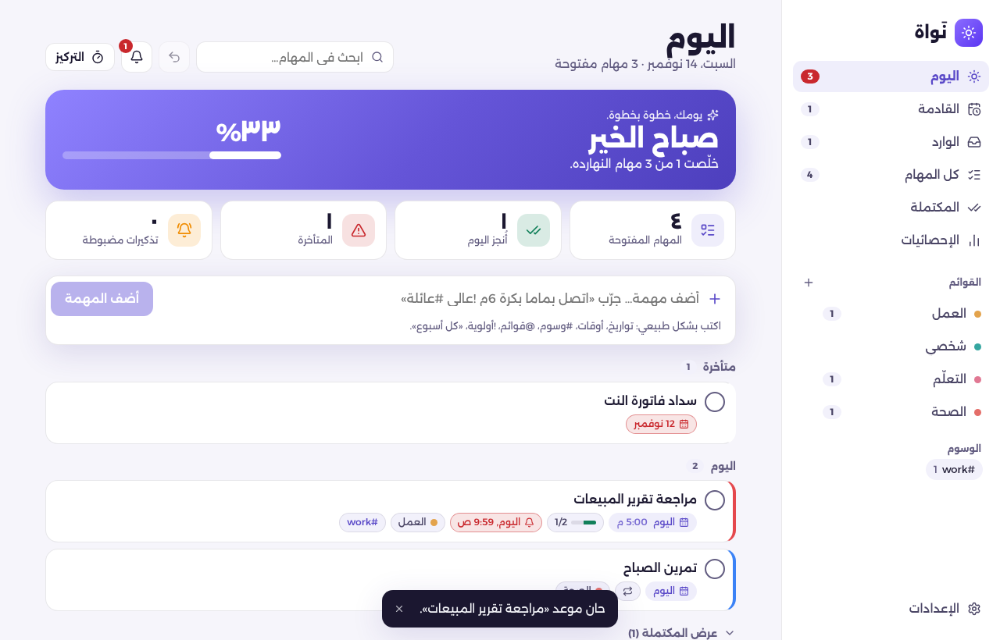
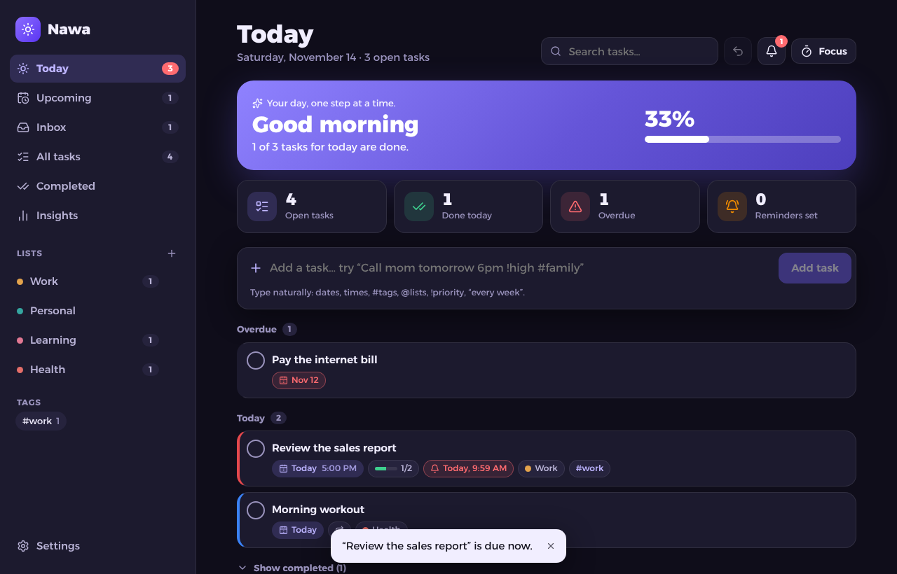
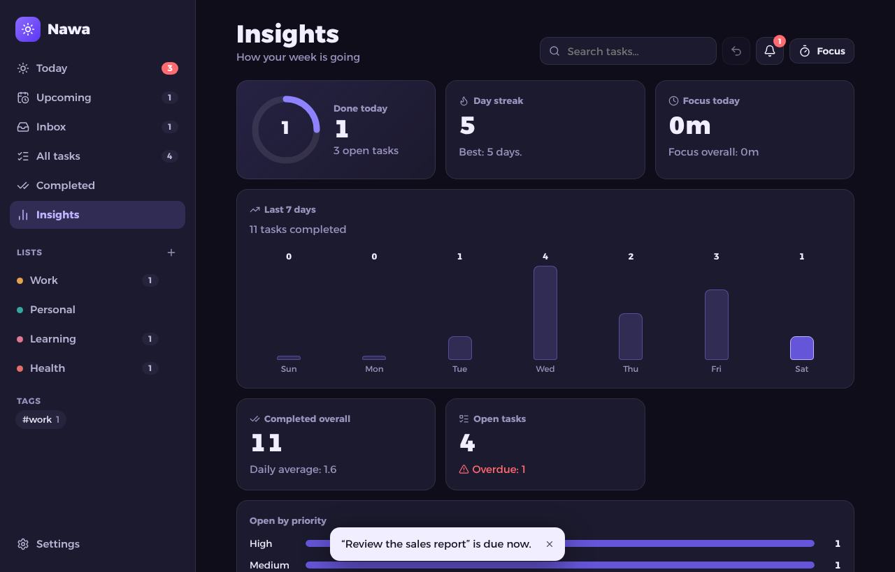
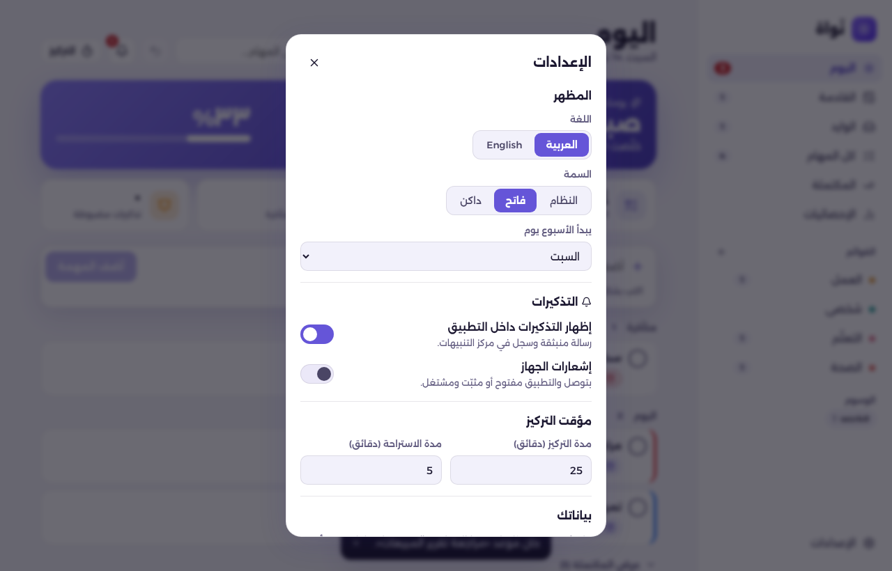

<div align="center">


# نَواة · Nawa

**مدير مهام عربي أولًا، يشتغل أوفلاين، وبيذكّرك في ميعادك.**
_An Arabic-first, offline-first task manager with reliable reminders._


[العربية](#العربية) · [English](#english)

</div>

<p align="center">
  
  
</p>

---

## العربية

### المميزات

- **إضافة سريعة بالكلام العادي** — اكتب «اشتري لبن بكرة 5م #بيت !عالي» والتطبيق يفهم التاريخ والوقت والأولوية والوسم.
- **تذكيرات حقيقية** — إشعارات داخل التطبيق ومركز إشعارات، وإشعارات النظام، مع **غفوة (Snooze)**. في تطبيقات الموبايل التذكير بيتجدول على مستوى نظام التشغيل فيشتغل والتطبيق مقفول.
- **قوائم ووسوم وتثبيت** — قوائم بألوان، وسوم، تثبيت المهام المهمة.
- **مهام فرعية** مع شريط تقدّم، و**مهام متكررة** (يوميًا، أيام العمل، أسبوعيًا، شهريًا).
- **سحب وإفلات** وترتيب بالكيبورد، بحث فوري، وفرز (يدوي، بالموعد، بالأولوية، بالإنشاء).
- **عرض القادم (Upcoming)** مجمّع بالأيام، وعرض اليوم والمتأخر.
- **تركيز (Pomodoro)** وبيتسجل الوقت على كل مهمة.
- **إحصائيات** — سلسلة الأيام المتتالية، رسم أسبوعي، وقت التركيز.
- **تراجع/إعادة (Undo/Redo)** و**لوحة أوامر**.
- **عربي (RTL) وإنجليزي**، وثيم فاتح/داكن/تلقائي.
- **مزامنة بين التابات**، نسخ احتياطي JSON كامل، وتصدير CSV.
- **إتاحة كاملة** (لوحة المفاتيح، قارئ الشاشة، اختبارات axe).
- **خصوصية** — كل البيانات على جهازك، بدون حساب وبدون تتبّع.

<p align="center">
  
  
  
</p>

### صيغة الإضافة السريعة

| تكتب                                                | النتيجة                   |
| --------------------------------------------------- | ------------------------- |
| `النهارده` / `بكرة` / `بعد بكرة`                    | اليوم / بكرة / بعد غد     |
| `الخميس` · `الخميس الجاي`                           | أقرب خميس · الخميس القادم |
| `بعد 3 ايام` · `بعد اسبوع`                          | تاريخ نسبي                |
| `5م` · `5 مساء` · `17:00`                           | الوقت                     |
| `!عالي` · `!متوسط` · `!بسيط` · `!!!`                | الأولوية                  |
| `#بيت`                                              | وسم                       |
| `@العمل`                                            | القائمة                   |
| `كل يوم` · `كل اسبوع` · `كل شهر`                    | تكرار                     |
| `tomorrow 6pm` · `next fri` · `in 3 days` · `!high` | نفس الشيء بالإنجليزي      |

الكلمات اللي مش مفهومة بتفضل في العنوان، فالتحليل ما بيبلعش معنى بالغلط.

### اختصارات

| المفتاح                     | الوظيفة       |
| --------------------------- | ------------- |
| `N`                         | مهمة جديدة    |
| `/`                         | بحث           |
| `Ctrl/⌘ + K`                | لوحة الأوامر  |
| `Ctrl/⌘ + Z` / `Ctrl/⌘ + Y` | تراجع / إعادة |

### التشغيل محليًا

المطلوب: **Node ≥ 22.12** (فيه `.nvmrc`) و npm ≥ 10.

```bash
npm install
npm run dev        # http://localhost:1420
```

| الأمر                                   | الوظيفة                                                  |
| --------------------------------------- | -------------------------------------------------------- |
| `npm run dev`                           | سيرفر التطوير                                            |
| `npm run build`                         | بناء الويب (PWA) في `build/`                             |
| `npm run preview`                       | معاينة البناء                                            |
| `npm run check`                         | lint + types + format + اختبارات الوحدة + verify + build |
| `npm test`                              | اختبارات الوحدة (Vitest)                                 |
| `npm run e2e`                           | اختبارات المتصفح (Playwright + axe)                      |
| `npm run build:native`                  | بناء نسخة الموبايل/الديسكتوب                             |
| `npm run mobile:android` / `mobile:ios` | فتح مشروع الموبايل                                       |
| `npm run mobile:android:debug`          | APK للتجربة                                              |
| `npm run desktop:dev` / `desktop:build` | تطبيق سطح المكتب (Tauri)                                 |
| `npm run verify:native`                 | فحص إعدادات المنصات                                      |

لو عندك Chromium جاهز: `PW_CHROMIUM_PATH=/path/to/chrome npm run e2e`.

### النشر

**Vercel:** استورد الريبو، والإعدادات جاهزة في `vercel.json` (Build: `npm run build:web`، Output: `build`).

**GitHub Pages / أي مسار فرعي:** ابنِ بمسار الريبو:

```bash
BASE_PATH=/اسم-الريبو/ npm run build:web
```

ثم ارفع محتوى `build/`. التطبيق بيستخدم hash routing فمفيش إعداد rewrite مطلوب.

**التثبيت كتطبيق (PWA):** افتح الموقع في Chrome/Edge/Safari واختر «تثبيت» / «إضافة للشاشة الرئيسية». لما يظهر إصدار جديد بيظهر شريط «تحديث».

### تطبيقات الموبايل والديسكتوب

تفاصيل كاملة في [`docs/NATIVE.md`](docs/NATIVE.md): أندرويد (Capacitor، JDK 21)، iOS (Mac + Xcode)، وسطح المكتب (Tauri 2: Windows / macOS / Linux AppImage).

> ⚠️ مسارات الموبايل والديسكتوب مفحوصة ثابتًا ووحدات الاختبار تغطي منطق الإشعارات، لكن البناء الفعلي والتجربة على الجهاز لازم تتم عندك.

### حدود التذكيرات (بصراحة)

- **على الويب:** التذكير بيشتغل طول ما التطبيق مفتوح أو مثبّت وشغّال. مفيش Web Push backend، فمتتوقعش إشعار والمتصفح مقفول.
- **على الموبايل (Capacitor):** التذكير بيتجدول مع نظام التشغيل (أقرب 60 تذكير، حد iOS 64) ويشتغل والتطبيق مقفول.
- البيانات محلية بالكامل ومفيش مزامنة بين الأجهزة — استخدم النسخ الاحتياطي للنقل.

### البيانات والنسخ الاحتياطي

- التخزين: `localStorage` (مفتاح `nawa:v3`)، مع تحقق Zod عند كل قراءة.
- **الإعدادات ← تصدير** ينزّل نسخة JSON كاملة (مهام، قوائم، إحصائيات، إعدادات). **استيراد** بيتحقق من الملف ويحافظ على لغتك وثيمك الحاليين.
- التصدير CSV متاح للمهام.
- **الترقية من Nawa 5.x:** أول تشغيل بيحوّل بياناتك القديمة تلقائيًا (التصنيفات ← قوائم، الأولويات، التذكيرات)، ونسخ 5.x الاحتياطية لسه تتستورد.
- مفيش حسابات ولا تتبّع ولا طلبات شبكة غير تحميل التطبيق نفسه.

### هيكل المشروع

```text
src/
  core/        منطق نقي: actions, selectors, quick-add, reminders, stats, dates, transfer, legacy
  state/       store مع undo/redo + تحقق + مزامنة تابات + alerts
  platform/    محوّل الويب/Capacitor/Tauri والتذكيرات الأصلية
  hooks/       تكاملات المتصفح: reminders, hotkeys, PWA, focus
  features/    الشاشات: tasks, alerts, settings, stats, focus, palette, shell
  components/  عناصر عامة
  i18n/        ar / en
  styles/      tokens + CSS بخصائص منطقية (RTL)
tests/e2e/     Playwright
src-tauri/     مشروع Tauri
native/        أصول أندرويد (أيقونات، قنوات)
docs/          المعمارية، ADRs، المراجعة، الموبايل
```

### توثيق

- [`docs/ARCHITECTURE.md`](docs/ARCHITECTURE.md) — الطبقات وتدفق التذكيرات
- [`docs/REVIEW.md`](docs/REVIEW.md) — مراجعة 5.1 وما تغيّر في 6.0
- [`docs/NATIVE.md`](docs/NATIVE.md) — بناء أندرويد/iOS/ديسكتوب
- [`docs/adr/`](docs/adr) — قرارات معمارية

---

## English

**Nawa** is a local-first task manager: natural-language quick add, subtasks, repeats, lists and tags, drag & drop, focus timer, insights, undo/redo, a command palette, Arabic (RTL) and English, and reminders that fire in-app, through the OS, and — in the Android/iOS builds — while the app is closed. Your data never leaves the device.

### Quick start

```bash
nvm use            # Node ≥ 22.12 (.nvmrc)
npm install
npm run dev        # http://localhost:1420
npm run check      # lint, types, format, 184 unit tests, native config check, build
npm run e2e        # Playwright + axe against the production build
```

### Quick-add examples

```text
Call mom tomorrow 6pm !high #family @Personal every week
Submit report next fri 17:00 !!!
اشتري لبن بكرة 5م #بيت
```

Shortcuts: `N` new task · `/` search · `Ctrl/⌘+K` command palette · `Ctrl/⌘+Z` / `Y` undo / redo.

### Deploy

- **Vercel** — import the repo; `vercel.json` is ready.
- **GitHub Pages / sub-path** — `BASE_PATH=/<repo>/ npm run build:web`, publish `build/`. Hash routing means no rewrites are needed.
- **Native** — see [`docs/NATIVE.md`](docs/NATIVE.md).

### Honest limitations

- Web reminders run only while the app is open or installed and alive (no Web Push backend).
- Android/iOS/Tauri builds are ported and statically verified but must be built and tested on a device/toolchain.
- No sync between devices; use the JSON backup.

### Tech

Vite 7 · React 19 + React Compiler · strict TypeScript · Zod 4 · dnd-kit · lucide-react · vite-plugin-pwa · Capacitor 8 · Tauri 2 · Vitest · Playwright + axe.

### Contributing

Run `npm run check` and `npm run e2e` before opening a PR. Business logic goes in `src/core` as pure functions with tests; platform-specific code goes only in `src/platform`.
