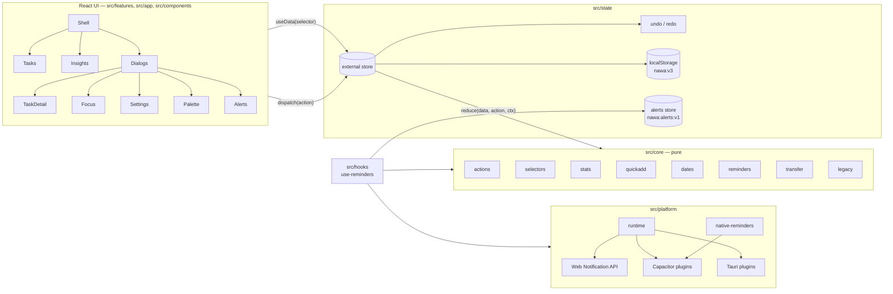
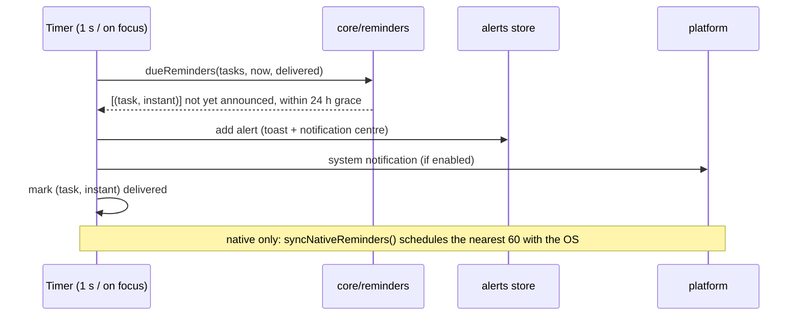

# Architecture

Nawa is a client-only app with optional native shells. Guiding rule: **logic is pure and framework-free; React only renders and wires; the platform layer is the only code that knows about Capacitor/Tauri.**

## Layers

| Layer      | Path             | Rules                                                                                   |
| ---------- | ---------------- | --------------------------------------------------------------------------------------- |
| Core       | `src/core`       | Pure TypeScript. No React/DOM/storage. Clock and ids are injected via `Context`.        |
| State      | `src/state`      | Small external store, validated persistence, undo/redo, alerts history, cross-tab sync. |
| Platform   | `src/platform`   | Web / Capacitor / Tauri differences behind one adapter; native plugins lazy-loaded.     |
| i18n       | `src/i18n`       | Typed `ar`/`en` dictionaries, CLDR plurals, direction.                                  |
| Hooks      | `src/hooks`      | Browser integrations: hotkeys, install, PWA update, reminders, focus timer, routing.    |
| Features   | `src/features`   | One folder per screen/area.                                                             |
| Components | `src/components` | Generic UI: button, modal (native `<dialog>`), toast, error boundary.                   |
| Styles     | `src/styles`     | Design tokens + plain CSS with logical properties (RTL for free).                       |

## Data flow

1. A component calls `dispatch({ type: "toggle", id })`.
2. The store builds `Context{ now, today, uid }` and runs `reduce(data, action, ctx)`.
3. The previous snapshot is pushed to history (preferences and focus bookkeeping are not undoable).
4. The new document is validated by Zod, persisted to `nawa:v3`, and subscribers re-render through `useSyncExternalStore` selectors.
5. A `storage` event in another tab triggers the same validation and replaces the local snapshot.

## Reminders

`reminderTime(task) = task.reminderAt ?? dueAt(task.due, task.time)`; completed tasks never remind.

- Delivery is keyed by `(taskId, instant)` so editing a time re-arms the reminder and a reload never repeats one.
- **Snooze** moves `reminderAt`; the key changes, so it fires again.
- Web reminders only run while the app is open or installed and alive; there is no push backend. Native builds hand reminders to the operating system, so they fire when the app is closed.

## Storage and migration

- `nawa:v3` — the whole document (tasks, lists, history, settings), validated on load; invalid data falls back to defaults.
- `nawa:alerts:v1` — notification-centre history; `nawa:delivered:v1` — delivered reminder keys.
- `core/legacy.ts` + `state/app.ts#migrateFromEarlierVersions` convert Nawa 5.x keys.

## Build modes

| Mode     | Command                | Base               | Service worker |
| -------- | ---------------------- | ------------------ | -------------- |
| `web`    | `npm run build:web`    | `BASE_PATH` or `/` | yes (Workbox)  |
| `native` | `npm run build:native` | `./`               | no             |

Both write to `build/`, which Vercel, Capacitor and Tauri all consume.

See `docs/adr/` for the reasoning behind these choices and `docs/REVIEW.md` for what 6.0 changed.
